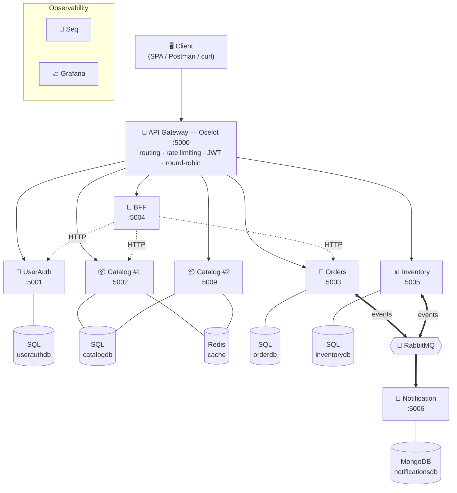
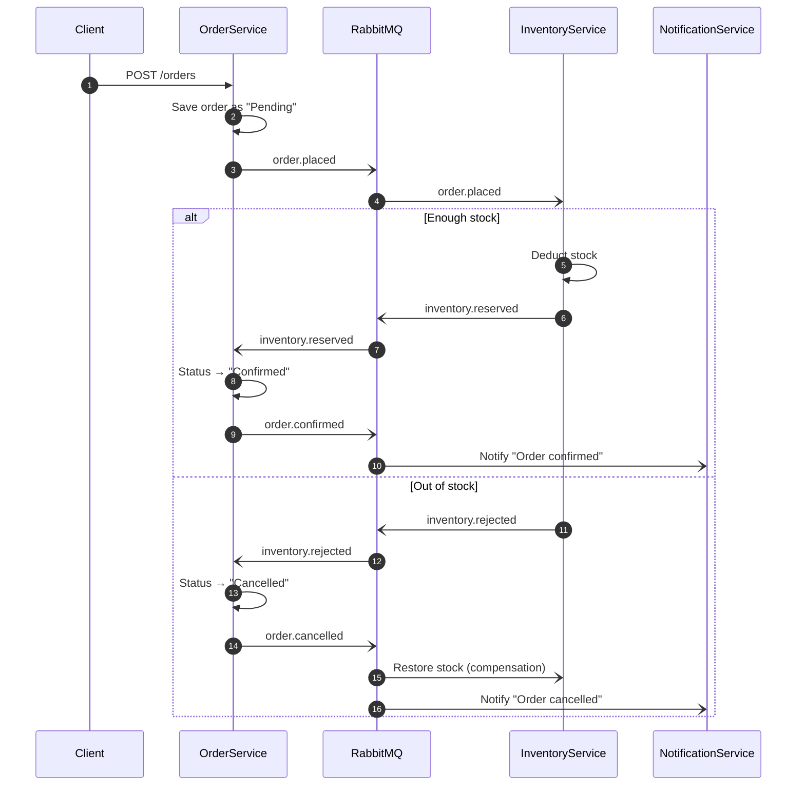

# 🏗️ Store API — Distributed Microservices Platform

> An e-commerce order system that evolves a .NET monolith into **8 independently deployable services** — with an API Gateway, BFF, async Saga over RabbitMQ, polyglot persistence, load balancing, caching, centralized logging and CI — all started with **one command**.

[](https://github.com/yael-72/architecture-project/actions/workflows/ci.yml)
[](https://dotnet.microsoft.com)
[](https://docs.docker.com/compose/)
[](https://www.rabbitmq.com)
[](https://redis.io)
[](https://www.microsoft.com/sql-server)
[](https://www.mongodb.com)
[](.github/workflows/ci.yml)

---

## ✨ Highlights

| | |
|---|---|
| 🔀 **Saga pattern (choreography)** | Orders are confirmed or cancelled through 6 async events, including a **compensation path** that restores stock |
| 🚪 **API Gateway + BFF** | Ocelot is the single entry point; a Backend-for-Frontend composes data from several services into one response |
| ⚖️ **Load balancing** | The catalog runs as **2 replicas** with round-robin; each response carries `X-Instance-Id` to prove it |
| 🗄️ **Polyglot persistence** | Database-per-service: SQL Server ×4, Redis (cache), MongoDB (notification events), each justified by an ADR |
| ⚡ **Cache-aside** | Redis caching of product reads, visible as `CACHE HIT` / `CACHE MISS` in the logs |
| 🔍 **Observability** | Serilog + Seq, a **Correlation ID** that flows through HTTP *and* the message broker, `/health` on every service, Grafana |
| 🔐 **Security** | JWT authentication, custom rate-limiting middleware, shared via a `SharedKernel` library |
| 🧪 **Testing & CI** | xUnit + Moq unit tests; a GitHub Actions pipeline that tests, builds and packages every service as a Docker image |
| 📐 **Documented decisions** | 5 Architecture Decision Records + a full architecture document |

---

## 🚀 Quick Start

```bash
git clone https://github.com/yael-72/architecture-project.git
cd architecture-project
docker compose up --build
```

That's it. SQL Server, Redis, RabbitMQ, MongoDB, Seq and Grafana start along with all services; databases are created and migrated automatically on first boot.

> **Prerequisite:** Docker Desktop (or Docker Engine + Compose v2).

### Service URLs

| Service | URL | Notes |
|---|---|---|
| **API Gateway** | http://localhost:5000 | Single entry point for all clients |
| **Seq (logs)** | http://localhost:5341 | Centralized structured logs |
| **RabbitMQ Management** | http://localhost:15672 | `guest` / `guest` |
| **Grafana** | http://localhost:3000 | `admin` / `admin` |
| Swagger — UserAuth | http://localhost:5001/swagger | Direct access (dev only) |
| Swagger — Catalog ×2 | http://localhost:5002/swagger · http://localhost:5009/swagger | Direct access (dev only) |
| Swagger — Orders | http://localhost:5003/swagger | Direct access (dev only) |
| Swagger — BFF | http://localhost:5004/swagger | Direct access (dev only) |
| Swagger — Inventory | http://localhost:5005/swagger | Direct access (dev only) |

All external traffic should go through the **API Gateway on port 5000**.

---

## 🧭 Architecture



### Services

| Service | Responsibility | Storage | Port |
|---|---|---|---|
| **ApiGateway** | Routing, rate limiting, load balancing | — | 5000 |
| **UserAuthService** | Registration, login, JWT issuance | SQL Server | 5001 |
| **ProductCatalogService** (×2) | Products & categories, paginated search | SQL Server + Redis | 5002 / 5009 |
| **OrderService** | Order lifecycle, saga entry point | SQL Server | 5003 |
| **BffService** | Aggregated, frontend-shaped views | Redis | 5004 |
| **InventoryService** | Stock levels, reserve / restore | SQL Server | 5005 |
| **NotificationService** | Customer notifications at saga end | MongoDB | 5006 |
| **SharedKernel** | Correlation ID, request logging, rate limiting, JWT helpers | — | library |

---

## 🔀 The Order Saga

Placing an order no longer deducts stock synchronously. Instead, services collaborate through events:



Every message carries the request's **Correlation ID**, so the whole saga can be traced in Seq with a single filter.

---

## 🎬 Try It Yourself

<details>
<summary><b>✅ Happy path — order confirmed</b></summary>

```bash
# 1. Register
curl -X POST http://localhost:5000/auth/register \
  -H "Content-Type: application/json" \
  -d '{"firstName":"Dana","lastName":"Levi","email":"dana@test.com","password":"Pass1234!","role":0}'

# 2. Login → copy the token
curl -X POST http://localhost:5000/auth/login \
  -H "Content-Type: application/json" \
  -d '{"email":"dana@test.com","password":"Pass1234!"}'

# 3. Seed inventory
curl -X PUT http://localhost:5000/inventory/1 \
  -H "Authorization: Bearer <token>" -H "Content-Type: application/json" \
  -d '{"productId":1,"stockQuantity":100}'

# 4. Place an order
curl -X POST http://localhost:5000/orders \
  -H "Authorization: Bearer <token>" -H "Content-Type: application/json" \
  -d '{"userId":1,"shippingAddress":"12 Jaffa St","orderItems":[{"productId":1,"quantity":2}]}'
```

Open Seq at http://localhost:5341 and filter by `CorrelationId` to watch the full saga.
</details>

<details>
<summary><b>↩️ Compensation path — out of stock</b></summary>

```bash
curl -X PUT http://localhost:5000/inventory/1 \
  -H "Authorization: Bearer <token>" -H "Content-Type: application/json" \
  -d '{"productId":1,"stockQuantity":0}'

curl -X POST http://localhost:5000/orders \
  -H "Authorization: Bearer <token>" -H "Content-Type: application/json" \
  -d '{"userId":1,"shippingAddress":"12 Jaffa St","orderItems":[{"productId":1,"quantity":2}]}'
```

Seq shows: `OrderPlaced → InventoryRejected → OrderCancelled → NotificationSent`.
</details>

<details>
<summary><b>⚖️ Load balancing</b></summary>

```bash
for i in $(seq 1 6); do
  curl -s -I http://localhost:5000/products | grep X-Instance-Id
done
# alternates between productcatalogservice1 and productcatalogservice2
```
</details>

<details>
<summary><b>⚡ Cache hit / miss</b></summary>

```bash
curl http://localhost:5000/products/1   # CACHE MISS → read from SQL, stored in Redis
curl http://localhost:5000/products/1   # CACHE HIT  → served from Redis
```
</details>

<details>
<summary><b>❤️ Health checks</b></summary>

```bash
for port in 5000 5001 5002 5003 5004 5005 5006 5009; do
  echo -n "$port → "; curl -s http://localhost:$port/health; echo
done
```
</details>

---

## 🛠️ Tech Stack

| Layer | Technology | Why |
|---|---|---|
| Runtime | .NET 8 / ASP.NET Core | Modern, fast, cross-platform |
| Gateway | Ocelot | Config-driven routing with built-in load balancing |
| Messaging | RabbitMQ 3.13 | Durable queues, AMQP standard, management UI |
| Relational DB | SQL Server 2022 + EF Core | ACID guarantees for users, orders and stock |
| Cache | Redis 7 | Sub-millisecond key-value reads with TTL |
| Document DB | MongoDB 7 | Append-only, document-shaped notification events |
| Logging | Serilog + Seq | Structured logs with `CorrelationId` on every line |
| Dashboards | Grafana | Visual monitoring of notification events |
| Testing | xUnit + Moq | Isolated unit tests for the order flow |
| CI | GitHub Actions | Test → build → Docker images on every push |
| Containers | Docker + Compose | One-command startup, isolated network |

---

## 📁 Project Structure

```
├── ApiGateway/              # Ocelot configuration (dev / prod)
├── UserAuthService/         # Auth, users, JWT
├── ProductCatalogService/   # Products, categories, Redis cache decorators
├── OrderService/            # Orders + saga consumers + typed HTTP clients
├── InventoryService/        # Stock + saga consumers (reserve / compensate)
├── NotificationService/     # Saga-completion consumers → MongoDB
├── BffService/              # Composers that aggregate several services
├── SharedKernel/            # Middleware & auth shared by all services
├── OrderService.Tests/      # Unit tests
├── docs/                    # Architecture doc, 5 ADRs, CI/CD notes, Grafana dashboard
├── .github/workflows/ci.yml # CI pipeline
└── docker-compose.yml       # The whole system in one file
```

Each service follows a clean layered structure: **Controllers → Services → Repositories → DbContext**, with interfaces for every dependency.

---

## 📐 Architecture Decision Records

- [ADR-001 — OrderService: SQL Server](docs/ADR-001-order-service-database.md)
- [ADR-002 — ProductCatalogService: SQL Server + Redis](docs/ADR-002-catalog-service-database.md)
- [ADR-003 — InventoryService: SQL Server](docs/ADR-003-inventory-service-database.md)
- [ADR-004 — Redis as a distributed cache](docs/ADR-004-redis-cache.md)
- [ADR-005 — RabbitMQ as the message broker](docs/ADR-005-rabbitmq-messaging.md)

📖 The full journey from monolith to microservices is in [docs/ARCHITECTURE.md](docs/ARCHITECTURE.md).

---

## 🧪 Running the Tests

```bash
dotnet test OrderService.Tests/OrderService.Tests.csproj
```

---

## 💡 What This Project Demonstrates

- Decomposing a monolith along business boundaries, with **database-per-service**
- Handling **distributed transactions** without 2PC, using a choreographed saga with compensation
- Choosing the right store per workload, and **documenting the trade-offs** in ADRs
- Making a distributed system **observable**: correlation IDs across HTTP and messaging, health checks, central logs
- Building resilient startup: health-checked dependencies, SQL retry policies, and migration retries for concurrent replicas
- Automating quality with **CI** and containerized builds

---

## 👩‍💻 Author

**Yael Turk** — Full-Stack Developer (C# · .NET · Angular · SQL)

[](https://github.com/yael-72)

⭐ If you found this project interesting, a star is always appreciated!
